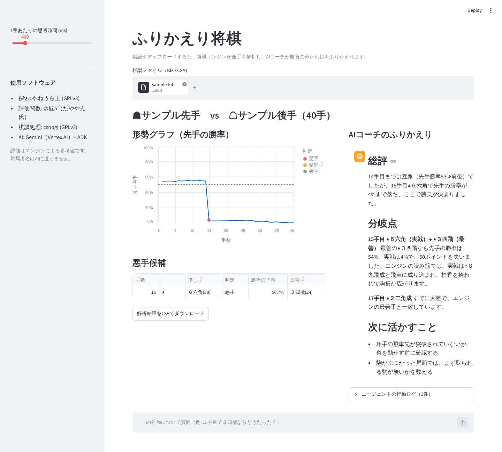

# ふりかえり将棋 — AIエージェントによる棋譜ふりかえり

自分の対局の棋譜を読み込み、**答えを見る前に、自分の感覚で手に印を付ける**。そのあと将棋エンジンの判定と突き合わせて
「感覚とデータのずれ」を見せ、AIエージェント（Gemini + ADK）が勝負どころを自分で選んで読み直し、講評を書く Web サービスです。

- 公開URL: https://shogi-web-4u4mgk5qka-an.a.run.app （ログインして使います）
- 将棋エンジン: [やねうら王](https://github.com/yaneurao/YaneuraOu)（[GitHub](https://github.com/yaneurao/YaneuraOu) / [Wiki](https://github.com/yaneurao/YaneuraOu/wiki)） + 評価関数 水匠5
- 第5回 Agentic AI Hackathon with Google Cloud（Zenn）への提出作品



（画面例。AIの文章は表示確認用のサンプルです）

## 目次

- [使い方の流れ](#使い方の流れ)
- [6つのラベルと、エンジンとの突き合わせ](#6つのラベルとエンジンとの突き合わせ)
- [機能の詳しい説明](#機能の詳しい説明)
- [設計の考え方](#設計の考え方) / [構成](#構成)
- [ローカルで動かす](#ローカルで動かすubuntu-2404-で確認) / [Google Cloud へのデプロイ](#google-cloud-へのデプロイ)
- [使用している将棋エンジン・評価関数](#使用している将棋エンジン評価関数) / [ライセンス](#ライセンス)

## 使い方の流れ

1. **ログイン**する（はじめての人はログイン画面の「新しい利用者を登録する」）
2. 最初の画面の「**棋譜を入力する**」で、棋譜ファイル（KIF / CSA）を読み込むか、テキストを貼り付けるか、画面の将棋盤で1手ずつ指して入れる
3. **自分が先手か後手か**を選び、局面図を手送りしながら、気になった手にだけ**印**（6つのラベル）を付ける。
   エンジンの解析は裏で始まっているが、**結果はこの入力を終えるまで見せない**（答えを見ながらでは学習にならないため）
4. 入力を完了すると、**ラベルごとのふりかえり**（印とエンジン判定の突き合わせ、局面図、その後の読み筋）と形勢グラフが出て、
   **AIエージェントのふりかえり**が自動で始まる。「15手目で３四飛ならどうだった？」のように質問すると、エンジンで確かめてから答える
5. 結果は **ふりかえりノート**（A4 の PDF / 印刷用ページ）として持ち帰れる。保存に同意した対局は、あとで開き直せ、
   **これまでの記録**と**大会に向けた傾向まとめ**に積み上がる

## 6つのラベルと、エンジンとの突き合わせ

選んだ手が自分の手か相手の手かで、選べるラベルが変わります。最初は「特に何も思わなかった」（印なし）が選ばれていて、
気になった手にだけラベルを選んで印を付けます。原因（選択式）、コメント、迷った別の読みは、どのラベルでも任意です（ラベルごとに10個まで）。

| | 悪手 | 中間 | 好手 |
| --- | --- | --- | --- |
| 自分の手 | 悪手だと思った | ほかにも指す手があった | 好手だと思った |
| 相手の手 | 悪手だと思った | 予想外で驚いた | 好手だと思った |

エンジンとの突き合わせは、決まった規則で分けます（AIは区分を決めません）。

| ラベル | 一致 | 感覚だけ | データだけ |
| --- | --- | --- | --- |
| 悪手だと思った | エンジンでも悪手・疑問手・緩手 | 勝率はほとんど下がっていない | エンジンでは悪手候補だが、印を付けていない（相手の手なら、咎め損ねたかもしれない手） |
| 好手だと思った | エンジンの最善手と同じ | 最善手とは違う | エンジンの**好手候補**だが、印を付けていない |
| ほかにも指す手があった・予想外で驚いた | 区分なし。エンジンの判定（最善手と同じか、悪手候補か）と迷った読みの評価を並べる | | |

- **悪手候補**: 評価値 cp を先手勝率 `1 / (1 + exp(-cp/600))` に直し、指した側の勝率が 20%以上下がれば「悪手」、10%以上「疑問手」、5%以上「緩手」
- **好手候補**: 最善手を指し、次善手なら勝率が10%以上低かった手。しきい値は仮の値です。取り返すしかない局面の当然の手も入り、
  思考時間が短いと結果が変わることがあります
- 以前の「悔しかった手」の印は、自分の手なら「悪手だと思った」、相手の手なら「予想外で驚いた」として読みます

## 機能の詳しい説明

<details>
<summary><b>ログインと利用者登録・パスワードの初期化</b></summary>

- 利用者名とパスワードでログインします。保存するのはパスワードのハッシュ（scrypt）だけです。同じ利用者名で5回続けて間違えると、5分間ログインできません
- 管理者は `python tools/add_user.py <利用者名>` で利用者を追加できます（公開しているサービスの利用者は `BUCKET=<バケット名>` を付けて実行）
- ログイン画面の「新しい利用者を登録する」から、画面でも登録できます。パスワードは8文字以上、すでにある利用者名は使えません。
  登録できる数には上限 `MAX_USERS`（既定30）があり、`SIGNUP_CODE` を設定すると登録に合言葉が要ります
- 登録のときに生年月日も入力します（保存するのはハッシュだけ）。パスワードを忘れたときは、ログイン画面の「パスワードを忘れた場合」で
  利用者名と生年月日が一致すれば、新しいパスワードに初期化できます（5回続けて間違えると5分間止めます）
- 生年月日を登録していない以前の利用者は、ログインしたあと左の欄の「生年月日を登録する」で、いまのパスワードを入れて登録できます

</details>

<details>
<summary><b>棋譜の入力</b></summary>

- 棋譜ファイル（.kif / .kifu / .csa / .txt）の読み込み、将棋アプリでコピーした棋譜のテキストの貼り付け、
  将棋盤の図（cshogi が描く盤）のマスを押して1手ずつ指す入力、のどれかで入れます
- 盤面での入力は平手のみ。指せる手だけ入力でき、成る・成らないは選べます。持ち駒は盤の上下のボタンから打ちます。
  「投了」ボタンで、そこまでの棋譜でふりかえりを始めます
- 読めないもの（指し手が無い、指せない手がある、400手を超える、200KBを超える、対応していない種類のファイル）は、理由を示して受け付けません。
  KI2 形式（「▲７六歩 △３四歩」と並べた形）には対応していません
- 自分が先手か後手かは必須です（印を付ける画面でも直せます）
- 思考時間は数字で入力します（0、または100〜3000ミリ秒）。0 にするとエンジンで解析せず、印とコメントだけを記録します
- 読み込んだ棋譜は、棋譜入力とふりかえりの両方の画面からダウンロードできます。ファイル名には押した時刻を秒まで付けます（例: `kifu_20261014-153012.kif`）
- 棋譜入力モードとふりかえりは、いつでも行き来できます（付けた印と解析結果は残ります。別の棋譜を読み込むと消えます）

</details>

<details>
<summary><b>印の入力と、裏で進む処理</b></summary>

- 手は「初期盤面」から前後ボタンかキーボードの ← → で送り、局面図では選んだ手のマスに色が付きます
- 入力途中の原因とコメントは、別の手に移っても残ります（ブラウザを再読み込みすると消えます）
- **棋譜を読み込むと、エンジンの解析は裏で自動的に始まります**。印の入力を完了すると解析結果を表示し、AIエージェントのふりかえりも自動で始まります。
  「印を付けずに、すぐ解析結果を見る」を押せば、棋譜だけで解析まで進みます
- 「いったん閉じて、あとで印を付ける」で、棋譜を保存して解析を裏で進めたまま閉じ、あとで「保存した対局」の「続ける」から印を付けられます
- AIエージェントへの依頼は裏で動かすので、待っているあいだに別の操作をしても、やり取りは消えません
- 画面を閉じた後も処理が最後まで進むことは保証していません（Cloud Run が接続の無いあいだ CPU を絞るため）
- 解析結果の画面の「ふりかえりをやり直す」で印を付け直せます（解析結果を見たあとの印であることを、その対局に記録します）

</details>

<details>
<summary><b>解析結果の画面</b></summary>

- **ラベルごとのふりかえり**（6つのタブ）に、印を付けた手の局面、エンジンの判定、その後の読み筋（最善手から・実戦の手から）、
  迷った読みの評価を並べ、AIエージェントの講評もラベルごとに書きます
- 「読み筋を盤で見る」で、最善手からの読み筋と実戦の手からの読み筋をポップアップで開き、1手ずつ盤で確かめられます（局面図の下にもあります）
- 形勢グラフや表の行を押すと、その手の局面図を表示します。講評の中の「15手目」などを押すと局面図がその手に移り、
  局面図で選んでいる手に触れている段落には色が付きます
- PC の幅では、上段の左に形勢グラフと局面図、右にAIエージェントの講評を並べ、表はその下に置きます（スマホの幅では縦に並びます）
- エンジンの読み筋が短く途切れたときは、終わりの局面を読み直して続きをつなげ、最大12手まで表示します
  （局面図の下、ふりかえりノートの回答、迷った別の読みの「その先」、AIエージェントの講評）
- 局面図（画面・PDF・印刷用ページ）では、**成り駒を赤い字**で描きます

</details>

<details>
<summary><b>迷った別の読み</b></summary>

- 印を付けるときに、その手を指す直前の局面の盤で**迷った別の読み**を入れられます（1つの印に3つまで、1つの読みは6手まで。
  相手の応手も入れられ、成る・成らないも選べます）
- 評価は印の入力を完了した後で、エンジンが読みの1手ずつの最善手と判定、読みの終わりの勝率（実戦の手の後と比べて、5%以上の差で「良い／悪い」）、
  その先の読み筋を出します。ふりかえりノートの「回答」にも載ります。「5%」は仮の値です

</details>

<details>
<summary><b>ふりかえりノート（PDF・印刷用ページ）</b></summary>

- A4。ラベルごとの表、形勢グラフ、ラベルごとに印を付けた手と自分の悪手候補の局面図、AIエージェントの文章
- 前半は「その手を指す直前の局面図」。後ろのページは「回答」で、エンジンの最善手を指した局面図と、最善手・実戦の手それぞれの
  **その後の読み筋**（エンジンが短い時間で読んだ想定手順、最大12手）を載せます（最善手は前半には書きません）
- PDFでダウンロードするか、印刷用ページを新しいタブで開いて印刷できます。AIエージェントへの質問と回答は、ノートの末尾に入ります

</details>

<details>
<summary><b>保存・これまでの記録・大会に向けた傾向まとめ</b></summary>

- **棋譜の保存は、本人が同意のチェックを入れたときだけ**行います（Cloud Storage の `games/<利用者>/`、30日で自動削除。対局者名を含む棋譜のまま保存します）。
  保存先（`BUCKET`）が無い環境では手元の `data/` フォルダーに保存し、自動では削除しません
- 保存にチェックを入れずに始めると確認が出ます（保存しない／保存する／保存せず、以後ログアウトまで確認しない）。
  「次回からも確認せずに保存する」を入れると、保存の同意のチェックが次回から最初に入ります（外せば元に戻ります）
- 保存しない場合も、解析のあいだは処理用のメモリで棋譜を扱い、AIエージェント（Gemini）には指し手とエンジンの数値を送ります
- 最初の画面の**保存した対局**から、解析結果・印・AIエージェントとのやり取りをいつでも開き直せます（解析はやり直しません。
  ふりかえりノートのPDFもそこからダウンロードできます）。一覧から削除もできます（元に戻せません）
- 最初の画面の**これまでの記録**は、保存に同意した対局を決まった規則で数えた結果です:
  選んだ原因の回数、自分が指した手のうち悪手候補だった割合（100%なら全部の手、0%なら悪手候補なし）、
  段階ごとの悪手候補の割合（序盤・中盤・終盤の順で固定）、悪手候補に自分で気づけた割合。
  AIエージェントは次のふりかえりでこの記録を道具（`past_tendencies`）から読みます。モデル自体の再学習はしていません
- 対局を保存するたびに、最初の画面の**大会に向けた傾向まとめ**を裏で作り直します（A4で3ページ以内のPDFと印刷用ページ）。
  1ページ目は、決まった規則で数えた「記録から言えること」と、Gemini が書いた「AIの所感」（箇条書き。記録に無い数字を含む行・長すぎる行は取り除く）。
  2〜3ページ目は、規則で選んだ局面例（最大4つ。悪手だと思った自分の手、気づかなかった悪手候補、予想外で驚いた相手の手、
  迷った読みのほうが良かった手）の局面図です。集計が前回と同じなら作り直しません（Gemini を呼びません）。
  Gemini が使えないときは、記録と局面例だけで作ります

</details>

## 設計の考え方

- **将棋の判断はエンジン、言葉にするのは Gemini。** 指し手の良し悪し・勝率・読み筋はすべてエンジンの数値。
  Gemini はツールの結果だけを根拠に書くよう指示し、どの局面を調べるかを自分で決める。
- **エージェントの道具（`shogi_coach/tools.py`）**
  | ツール | 何をするか |
  | --- | --- |
  | `analyze_game` | 全手を短時間で解析し、形勢の推移と悪手候補・好手候補を返す |
  | `deep_dive(ply)` | 指定局面を2秒・候補手3つで読み直し、実戦の手と比べる（1回のふりかえりで最大6局面） |
  | `compare_move(ply, move)` | 別の手を指していたらどうだったかを比べる（日本語の指し手も可） |
  | `regret_gap` | 本人が付けた6つのラベルの印と、エンジンの判定とのずれを返す |
  | `past_tendencies` | 本人が保存に同意した、これまでの対局の集計を返す（今回の対局は含まない） |
- **印は本人が付ける。** エンジンやAIは代わりに付けない。ずれの区分は決まった規則（`shogi_analyzer/regret.py`）で分け、
  AIはその結果を文章にするだけ。コメントは命令ではなくデータとして扱うよう指示している。
- **セキュリティ**: エンジンAPIは非公開（IAM認証、web のサービスアカウントだけが呼べる）。Gemini は Vertex AI を
  サービスアカウントで呼び、APIキーを持たない。対局者名・棋譜コメントはモデルに送らない。入力は手数・サイズ・合法性を検査。
- **可観測性**: ツール呼び出しの開始・終了・所要時間・エラーを JSON で標準出力に出し、Cloud Logging で追える。
  画面にも「エージェントの行動ログ」を表示する。

## 構成

```
ブラウザ ─HTTPS→ Cloud Run: shogi-web（Streamlit + ADK エージェント）
                    ├─ Vertex AI: Gemini 3.8 Flash
                    ├─ Cloud Run: shogi-engine（FastAPI + やねうら王 + 水匠5, IAM認証）
                    └─ Cloud Storage（棋譜・結果, 30日で自動削除）
```

| パス | 内容 |
| --- | --- |
| `app.py` | Streamlit 画面 |
| `shogi_coach/` | ADK エージェント（`agent.py`）、ツール、エンジン呼び出し、保存 |
| `engine_service/` | shogi-engine（FastAPI）と Dockerfile |
| `shogi_analyzer/` | USI クライアント、棋譜読み込み、全手解析・深掘り・比較の共通処理 |
| `deploy/setup.sh`, `cloudbuild.yaml`, `web.Dockerfile` | Google Cloud へのデプロイ |
| `Dockerfile` | 1サービスにまとめた簡易版（エンジン同梱） |

## ローカルで動かす（Ubuntu 24.04 で確認）

```bash
# 1. エンジン（約1〜2分でビルド）と評価関数
git clone https://github.com/yaneurao/YaneuraOu.git
make -C YaneuraOu/source -j"$(nproc)" normal COMPILER=g++ TARGET_CPU=AVX2 YANEURAOU_EDITION=YANEURAOU_ENGINE_NNUE
mkdir -p engine/eval && cp YaneuraOu/source/YaneuraOu-by-gcc engine/YaneuraOu
curl -L -o Suisho5.7z https://github.com/yaneurao/YaneuraOu/releases/download/suisho5/Suisho5.7z
7z x -oengine/eval Suisho5.7z

# 2. Python
pip install -r requirements.txt -r engine_service/requirements.txt pytest

# 3. Vertex AI（AIエージェントを使う場合）
gcloud auth application-default login
export GOOGLE_CLOUD_PROJECT=<プロジェクトID>   # Cloud Shell では設定済み。Vertex AI・global は既定値

# 4a. 1プロセスで起動（エンジンも同じプロセス）
streamlit run app.py

# 4b. 本番と同じ2プロセス構成で起動
uvicorn engine_service.main:app --port 8081 &
ENGINE_URL=http://localhost:8081 streamlit run app.py
```

エージェント単体は `adk web` でも試せます（`shogi_coach` を選び、状態に棋譜を入れる必要あり）。

テスト: `python -m pytest tests`（エンジンAPI、Gemini の代わりに台本モデルを使ったエージェントの通し確認、
印とエンジン判定の突き合わせ、局面図、ふりかえりノートのPDF・印刷用ページ）

## Google Cloud へのデプロイ

```bash
export PROJECT_ID=<プロジェクトID>
bash deploy/setup.sh
```

API の有効化、サービスアカウントと最小権限、バケット（30日削除）、2イメージのビルド、2サービスのデプロイまで行います。
最後に予算アラートをコンソールで設定してください。

## 使用している将棋エンジン・評価関数

この作品の解析は、次の将棋エンジンと評価関数で行っています。開発者の皆さまに感謝します。

- **やねうら王**（探索エンジン。作者: やねうらお氏）
  - GitHub: https://github.com/yaneurao/YaneuraOu
  - Wiki: https://github.com/yaneurao/YaneuraOu/wiki
  - ライセンス: GPL-3.0（Stockfish・Apery などの GPL-3.0 のコードを含みます）
  - 使い方: コミット `c1b80ea`（V9.80git）のソースを Docker のビルド時に取得し、**改変せずに**ビルドしています。
    このリポジトリにはやねうら王のソースも実行ファイルも含めていません。Python からは標準入出力の USI プロトコルだけで通信します。
- **水匠5**（NNUE評価関数。作者: たややん氏 https://x.com/tayayan_ts ）
  - 配布元: やねうら王の公式 Releases https://github.com/yaneurao/YaneuraOu/releases/tag/suisho5
    （作者の提供による公開。ビルド時にここから取得し、このリポジトリには含めていません）
  - 明示的なライセンス表記は見当たりません（2026-10-15 に配布ページで確認）。商用で使う前には作者に利用条件を確認します。

このサービスは、やねうら王・水匠の作者による公式のものではありません。エンジンの評価は参考値です。
公開しているWebサービスのフッターにも同じクレジットを表示しています（`shogi_analyzer/credits.py`）。
## ライセンス

本リポジトリのコードは GPL-3.0 です（[LICENSE](LICENSE)）。
やねうら王（GPL-3.0）と cshogi（GPL-3.0）を使っているため、このリポジトリのソースコード全体を GPL-3.0 で公開しています。
エンジン・評価関数・ライブラリの条件は [THIRD_PARTY_LICENSES.md](THIRD_PARTY_LICENSES.md) を参照してください。
エンジン実行ファイルと評価関数ファイルは本リポジトリに含めません。
