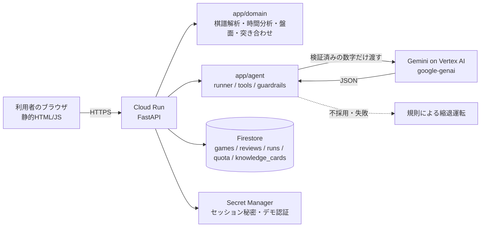

# アーキテクチャ

## 流れ(2回のエージェント実行を、本人の印づけで挟む)
1. 棋譜(KIF)を貼る → `kif_parser` → 時間分析 → 局面の再現(`board`)。ここまでLLMなし
2. 実行1 `POST /agent/questions`: 候補印を最大5件。画面に薄く出すだけで、印にはならない
3. 本人が振り返りビューで「ここが悔しかった」を押して印をつける(`PUT /marks/{n}`)
4. 実行2 `POST /agent/report`: 本人の印と時間データを突き合わせ(`compare`)、考える問題、知識カード、AI所感
5. PDF(`/report.pdf`)。実行記録(ツール呼び出し、LLM採否)もレポート画面に出る

## エージェントの制御
- ツールは7個の許可リスト(`tools.py`)。呼び出し回数の上限は `Settings.max_tool_calls` / `max_llm_calls`
- LLM出力は JSONスキーマ → 手番号の存在・候補集合内 → 文字数 → 断定語 → 数字が与えたデータ由来か、の順に検証。落ちたら理由つきで再試行(最大2回)→ 縮退
- `brain.py` の `Brain` インターフェース(suggest / narrate)を差し替えれば、ADKなど別の実装にできる

## Firestoreのデータ構造
- `games/{id}`: 対局本体(moves、派生値、ownerUid、expireAt)。`sample=True` はTTLなし
- `games/{id}/reviews/{moveNo}`: 本人の印 / `games/{id}/runs/{runId}`: 実行記録
- `quota/{uid}_{yyyymmdd}`: 1日の実行回数 / `knowledge_cards/{id}`
- 複合インデックスを避けるため、並べ替えはPython側で行う
