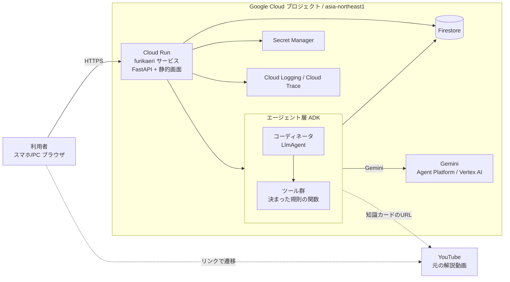
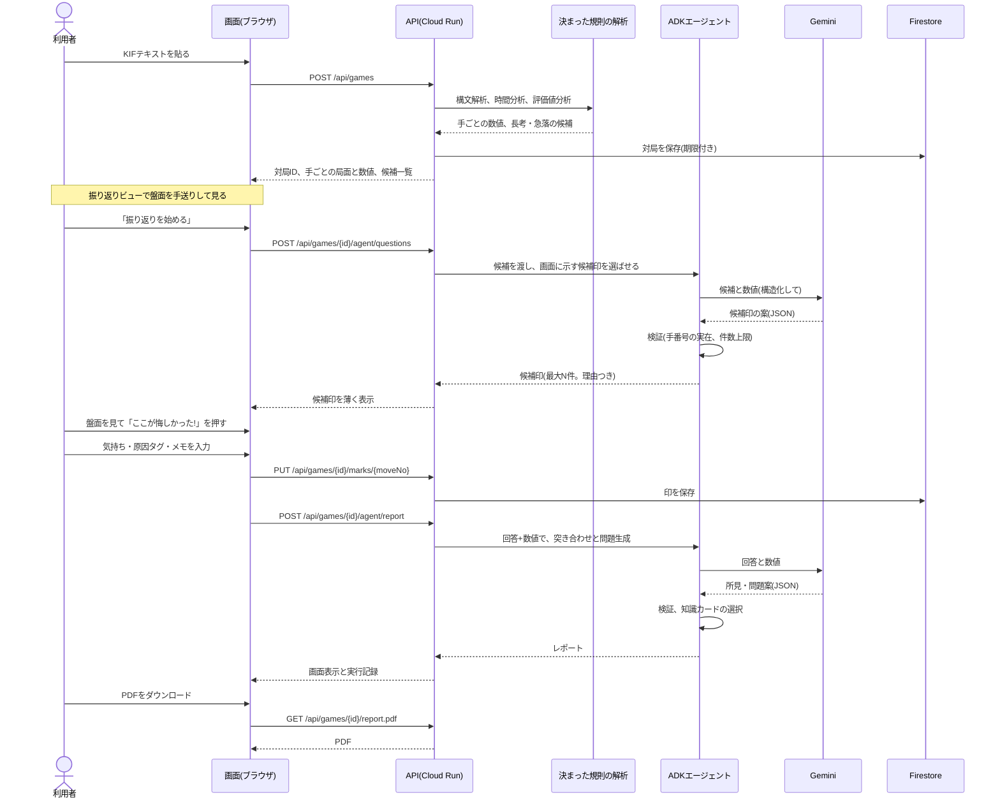
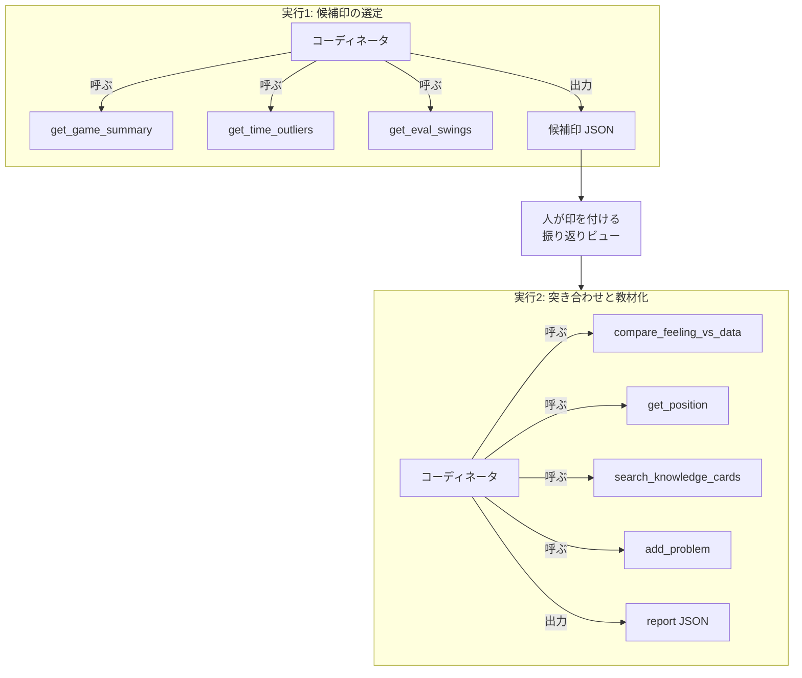

# 03 設計図:ふりかえり将棋(仮称)

作成日: 2026-10-10 / 最終更新: 2026-10-11 19:50 JST(振り返りビューを反映)
読み方: 図はMermaid記法(GitHubとClaude Docsで描画される)。描画できない環境向けに、構成図だけASCII版も付ける。
提出用の構成図画像は、この図を元に作る(既存の`scripts/make_architecture_png.py`を改修するか、Mermaidから書き出す)。

---

## 1. 全体構成



ASCII版

```
[利用者ブラウザ]
      | HTTPS
      v
[Cloud Run: furikaeri (FastAPI)] --> [Firestore]
      |   \--> [Secret Manager]
      |   \--> [Cloud Logging / Trace]
      v
[ADK エージェント層]
   コーディネータ(LLM) --> ツール(KIF解析, 時間分析, 評価値分析, 突き合わせ, 問題生成, 知識検索)
      |
      v
[Gemini (Agent Platform / Vertex AI)]

知識カードのリンク ---> [YouTube(リンク遷移のみ。取得・保存はしない)]
```

使うGoogle Cloudの製品(ハッカソンの必須条件との対応)
- 実行基盤: **Cloud Run**(必須条件の「アプリケーション実行プロダクト」)
- AI技術: **ADK**、**Gemini(Agent Platform / Vertex AI)**(必須条件の「AI技術」)
- 補助: Firestore、Secret Manager、Cloud Logging、Cloud Trace、Cloud Build(`gcloud run deploy --source`で利用)

## 2. 処理の流れ(シーケンス)



## 3. エージェントの構成



設計の原則
1. **数値は決まった規則の関数が出す**。LLMは数値を作らない・変えない
2. LLMの仕事は、(a) どの候補を画面に示すか(候補印)の選定、(b) 回答と数値の突き合わせの文章化、(c) 問題の解説文、(d) 知識カードの選択
3. LLMの出力はJSON(スキーマ固定)で受け、検証関数で弾く
4. 人の印が必要な箇所で止まる(2回の実行に分ける)。エージェントが印や回答を代筆しない

## 4. データフロー(何をどこへ持つか)

| データ | 発生 | 保存先 | 保持期間 | 外部送信 |
|---|---|---|---|---|
| KIF原文 | 利用者が貼る | Firestore `games` | 既定30日(TTL) | しない |
| 手ごとの数値 | 解析 | Firestore `games`内 | 同上 | しない |
| 局面と数値(要約) | エージェント | Geminiへ送信 | 保存しない設定を確認(未確認) | Gemini(Google Cloud内) |
| 印(気持ち・原因タグ・メモ) | 利用者 | Firestore `reviews` | 同上 | Geminiへ(突き合わせのため) |
| 知識カード | 発案者が登録 | Firestore `knowledge_cards` | 恒久 | しない(画面にリンクのみ) |
| PDF | 生成 | **保存しない**(その場で返す) | - | しない |
| 実行記録 | エージェント | Cloud Logging / Trace | ログの既定保持期間 | しない |

## 5. Firestore のデータ構造

```
users/{uid}                 ※審査員用テストアカウントのみ(合言葉/メール+パスワード)
games/{gameId}
  ownerUid: string
  createdAt, expireAt: timestamp      ← expireAt にTTLを設定
  source: "kif"
  kifRaw: string
  meta: { sente, gote, startedAt, timeRule, result }
  moves: [ { n, text, spentSec, cumSec, evalCp|null, evalMate|null, pv|null } ]
  derived: { timeStats, outliers[], swings[] }    ← 決まった規則の結果
  reviews/{reviewId}
    moveNo: int
    feeling: "regret"|"unsure"|"ok"
    causeTags: [string]
    note: string
    source: "user"|"followup"     ← 利用者が自分で付けた印か、追加質問への回答か
  runs/{runId}
    kind: "questions"|"report"
    startedAt, finishedAt
    steps: [ { tool, args, resultSummary, ms } ]   ← 実行記録
    output: object
    guardrail: { llmCalls, rejected, reasons[] }
knowledge_cards/{cardId}
  proName, videoTitle, channel, url, startSec
  themes: [string]               ← 原因タグと対応
  summaryOwnWords: string        ← 自分の言葉の要約(転載しない)
  addedBy, addedAt
```

TTL: 公式ドキュメントでFirestoreのTTLポリシーの設定方法を確認して設定する(mimamoriで`sessions.expire_at`に設定した経験を流用)。

手ごとの局面(盤面と持ち駒)は保存しない。指し手から再現して返す(`GET /api/games/{id}/positions`)。1局あたりの処理時間は、実装時に測る。

## 6. API一覧

| メソッド | パス | 概要 | 認証 |
|---|---|---|---|
| GET | `/healthz` | 稼働確認 | 不要 |
| POST | `/api/login` | テストアカウントのログイン | 不要 |
| POST | `/api/games` | KIF貼り付け、解析、保存 | 要 |
| GET | `/api/games` | 自分の対局一覧 | 要 |
| GET | `/api/games/{id}` | 対局の詳細(手ごとの数値) | 要 |
| POST | `/api/games/{id}/agent/questions` | 候補印の選定を実行(パス名は仮。実装時に`/agent/suggestions`へ改名してよい) | 要 |
| GET | `/api/games/{id}/positions` | 手ごとの局面(盤面と持ち駒)。振り返りビューが使う | 要 |
| GET | `/api/games/{id}/marks` | 印の一覧 | 要 |
| PUT | `/api/games/{id}/marks/{moveNo}` | 印の追加・更新(気持ち、原因タグ、メモ) | 要 |
| DELETE | `/api/games/{id}/marks/{moveNo}` | 印の取り消し | 要 |
| POST | `/api/games/{id}/agent/report` | 突き合わせと教材化を実行 | 要 |
| GET | `/api/games/{id}/runs` | 実行記録の取得 | 要 |
| GET | `/api/games/{id}/report.pdf` | PDF生成 | 要 |
| DELETE | `/api/games/{id}` | 対局と関連データの削除 | 要 |
| GET | `/api/knowledge` | 知識カード一覧 | 要 |

## 7. 画面

```
[ログイン] → [対局一覧] → [貼り付け/取り込み]
                 |
                 +→ [振り返りビュー]  ← 中心の画面
                        |   盤面(手送り)、時間グラフ、手順リスト
                        |   「ここが悔しかった!」ボタン、印の詳細(気持ち・原因タグ・メモ)
                        |
                        +→ [レポート]   感覚とデータのずれ、所見、問題一覧、知識カード
                        |        [PDFをダウンロード]
                        +→ [実行記録]   エージェントが何を呼び、何を弾いたか
```

振り返りビューの配置(スマホ幅360pxを基準。PCでは盤面と一覧を左右に並べる)

```
+------------------------------+
| 対局情報          [自分: 先手] |
+------------------------------+
|                              |
|          盤面(9x9)          |  ← 自分の手番が手前。持ち駒も表示
|                              |
+------------------------------+
| |<   <    57手目    >   >|   |  ← 手送り(スライダーも)
| [   ここが悔しかった!   ]     |  ← 現在の手に印を付ける
+------------------------------+
| 時間グラフ(手ごとの棒+残り時間)|  ← 長考に目印。タップでその手へ移動
+------------------------------+
| 印の一覧 / 手順リスト          |  ← 候補印(薄い)と本人の印(濃い)
+------------------------------+
```

- 印を付けると、下から詳細パネルが出る(気持ち: 悔しい/迷った/問題なし、原因タグ、メモ)
- エージェントの候補印は薄く、本人の印は濃く表示し、凡例を置く
- 詳しい仕様は 04の16章

画面は既存mimamoriの静的配信方式(`app/static`)を踏襲し、フレームワークを増やさない。盤面の描画は、PDFの局面図と同じ描画を使う(04の16.3)。

## 8. PDFの構成

1. 表紙: 対局情報(日付、手合、結果)、今回の一言(最大の気づき)
2. ノート(1〜2ページ)
   - 時間の使い方(グラフ、長考の手)
   - 感覚とデータのずれ(表)
   - 次に意識すること(1〜3点)
   - 参照先(知識カード:棋士名、動画タイトル、リンク)
3. 問題集
   - 1問につき1局面図、手番、「この局面の最善手は?」
   - 本人が悔しいと答えた手を優先して採用
4. 解答編: 解答、読み筋(元データにある場合)、解説文(AI所感と明記)
5. 末尾: 免責(評価値は参考値、AIの文は推測を含む)

## 9. 構成上の判断と理由

| 判断 | 理由 |
|---|---|
| 将棋エンジンを自前で動かさない(初版) | 期限が短く、Cloud Run上での運用とライセンスが未確認。まずKIFの解析コメントを使う |
| エージェントを2回に分ける | 人の印を待つ箇所で止め、エージェントの代筆を防ぐ |
| 悔しさの印は、盤面を見ながら本人が付ける(2026-10-11 19:43 JSTの要望) | 悔しさは本人の感覚で、エージェントが決めない。盤面と時間を見ながら付けられる形にした。手番号を思い出して入力する形より迷いにくいと考えたが、未検証(プロトタイプで確かめる) |
| PDFを保存しない | 保存先・期限・削除の管理を減らす。個人データの滞留を避ける |
| 画面は静的ファイル | 既存資産を流用でき、追加の学習が要らない |
| ADKを使い、Cloud Runの単一サービスに同居 | デプロイと運用を1つにまとめる。ADKはCloud Run向けの公式手順がある |

髙橋瞭太
