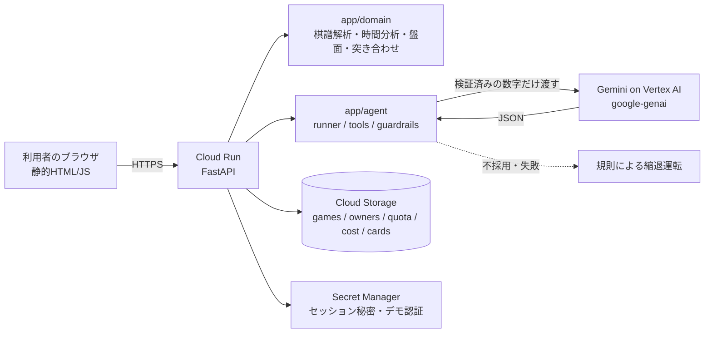

# アーキテクチャ



## 流れ(2回のエージェント実行を、本人の印づけで挟む)
1. 棋譜(KIF)を貼る → `kif_parser` → 時間分析 → 局面の再現(`board`)。ここまでLLMなし
2. 実行1 `POST /agent/questions`: 候補印を最大5件。画面に薄く出すだけで、印にはならない
3. 本人が振り返りビューで「ここが悔しかった」を押して印をつける(`PUT /marks/{n}`)
4. 実行2 `POST /agent/report`: 本人の印と時間データを突き合わせ(`compare`)、考える問題、知識カード、AI所感
5. PDF(`/report.pdf`)。実行記録(ツール呼び出し、LLM採否)もレポート画面に出る

## エージェントの制御
- ツールは7個の許可リスト(`tools.py`)。呼び出し回数の上限は `Settings.max_tool_calls` / `max_llm_calls`
- LLM出力は JSONスキーマ → 手番号の存在・候補集合内 → 文字数 → 断定語 → 数字が与えたデータ由来か、の順に検証。落ちたら理由つきで再試行(最大2回)→ 縮退
- `brain.py` の `Brain` インターフェース(suggest / narrate)を差し替えれば、ADKなど別の実装にできる

## Cloud Storage のファイル構造(既定の保存先。`STORE=gcs`)
```
games/{id}/game.json             対局本体(棋譜の解析結果、ownerUid)
games/{id}/marks/{moveNo}.json   本人の印
games/{id}/runs/{runId}.json     実行記録(トークン数、概算費用を含む)
owners/{uid}/{id}                利用者ごとの一覧用の目印(空ファイル)
quota/{uid}_{yyyymmdd}.json      実行回数 / cost/{yyyymmdd}.json  1日の概算費用の合計
cards/{id}.json                  知識カード(期限なし)
```
- 30日で自動削除: バケットのライフサイクル規則(`scripts/gcs_lifecycle.json`)。対象は `games/ owners/ quota/ cost/`。`cards/` は消えない
- 作成から30日で消えるので、本体・印・実行記録・目印がそれぞれ別の時刻に消える。本体が先に消えた目印は、一覧で飛ばす
- サンプル局は、ログイン時に無ければ入れ直す
- カウンタは、読んだ版が変わっていなければ書く方式(競合したらやり直す)で更新する
- `STORE=firestore`(Firestore版)も残してあるが、既定ではない。`STORE=memory` は開発・試験用
