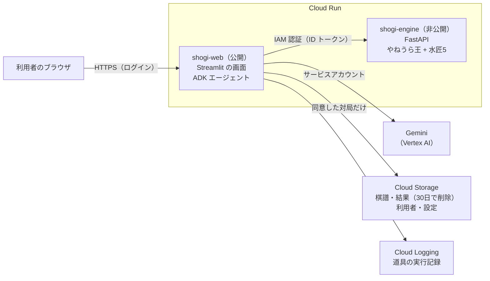

第5回 Agentic AI Hackathon with Google Cloud の提出作品です。

## 一言でいうと

将棋の棋譜を入れると、まず**自分で「悔しかった手」と「好手」に印を付け**、そのあと将棋エンジンの解析と比べて、**感覚とデータのずれ**を見せる Web サービスです。AI コーチ（Gemini + ADK）が勝負どころを自分で選んで調べ、ふりかえりを書きます。結果は A4 のノート（PDF）として手元に残せます。

- 公開先: Cloud Run（ログインが必要です）
- 使っている技術: Cloud Run / Gemini（Vertex AI）/ Agent Development Kit（ADK）/ Cloud Storage / やねうら王 + 水匠5 / cshogi / Streamlit

## 誰の、どんな困りごとか

作った本人は、将棋ウォーズ初段・将棋歴10年のアマチュアです。課題は自分の経験から出ています。

- 対象は、将棋アプリで指す中級者（初段前後）
- いまの将棋アプリや解析サービスでも、評価値のグラフや悪手の一覧で「どこで形勢が傾いたか」は見えます
- それでも、次の3つが残ります
  1. 見えるだけで、「次に何を直すか」が決まらない
  2. 負けて悔しかった手と、実際に形勢を壊した手がずれていても、気づけない
  3. アプリを閉じると、振り返りが手元に残らない

特に2つ目が、この作品の出発点です。「あの手が悪かった」と思い込んでいた手が、エンジンではほとんど損をしておらず、気にも留めなかった別の手で負けていた。このずれは、**答えを見る前に自分の感覚を書き出しておかないと**見えません。

## どう解決するか

### 1. 答えを見る前に、自分で印を付ける

棋譜を読み込むと、局面図を手送りしながら、悔しかった手に印を付け、原因（読み抜け、焦り・早指し、時間不足、定跡・形を知らなかった、など）を選びます。好手だと思った手にも印を付けられます。

**解析結果は、この入力を終えるまで画面に出しません。** エンジンの解析そのものは棋譜を読み込んだ時点で裏で始めていますが、見せるのは印を付け終えたあとです。答えを見ながら付けた印では、ずれが分からないからです。

印を付けるのは、いつも本人です。AI は印を代わりに付けません。

### 2. 感覚とエンジンのずれを、決まった規則で3つに分ける

| 区分 | 意味 |
|---|---|
| 一致 | 悔しかった手が、エンジンでも悪手・疑問手・緩手 |
| 感覚だけ | 悔しかったが、エンジンでは勝率がほとんど下がっていない |
| データだけ | エンジンでは自分の悪手候補だが、印を付けていない |

この区分は AI が決めるのではなく、決まった規則（勝率の下落が 20% 以上で悪手、10% で疑問手、5% で緩手）で分けます。好手についても同じ考え方で、本人の好手の印と、エンジンの最善手・好手候補を突き合わせます。

### 3. AI コーチが、勝負どころを自分で選んで調べる

解析と印の入力が終わると、AI コーチのふりかえりが自動で始まります。コーチは次の道具を自分の判断で使います。

| 道具 | 何をするか |
|---|---|
| `analyze_game` | 全手の形勢の流れと、悪手候補・好手候補を得る |
| `regret_gap` | 本人の印とエンジンの判定のずれを得る |
| `past_tendencies` | 本人がこれまでに保存した対局の傾向を得る |
| `deep_dive(ply)` | 選んだ局面を長く読み、候補手3つと実戦の手を比べる |
| `compare_move(ply, move)` | 「この手ならどうだった？」をエンジンで確かめる |

どの局面を深く調べるかは、コーチが決めます。本人が印を付けた手、勝率が大きく動いた手、形勢が逆転した直前の手などから、2〜4か所を選びます。ふりかえりのあとは、「15手目で３四飛ならどうだった？」のように質問でき、コーチはエンジンで確かめてから答えます。

### 4. 手元に残る

- **ふりかえりノート（PDF・印刷用ページ）**: ずれの表、形勢グラフ、局面図をまとめます。前半は「その手を指す直前の局面図」だけを載せた問題、後ろのページが「回答」で、エンジンの最善手と、その後の読み筋を載せます。AI コーチの講評と、質問・回答も末尾に入ります
- **保存した対局**: 本人が同意した対局は保存され、あとから解析結果を開き直せます。途中で閉じて、あとで続きから印を付けることもできます
- **これまでの記録**: 保存した対局から、選んだ原因の回数、悪手候補が出た段階（序盤・中盤・終盤）、悪手候補に自分で気づけた数を集計します。AI コーチは次のふりかえりでこの記録を読み、「今回も同じ傾向か」を伝えます

## 自律性と、その制御

「AI に将棋を語らせる」と、もっともらしい間違いを書きます。そこで、役割をはっきり分けました。

- **数値はエンジンと決まった規則が出す。AI は数値を作らない。** 指し手の良し悪し、勝率、読み筋はすべて将棋エンジン（やねうら王 + 水匠5）の出力です。Gemini には、道具の結果にある手と数字だけを使うよう指示しています
- **AI が決めること**: どの局面を深く調べるか、質問に答えるためにどの道具を呼ぶか、結果をどう言葉にするか
- **人が決めること**: 悔しさの印、原因、コメント。保存するかどうか
- **道具は許可リストで固定**: Web 検索や URL の取得は持たせていません。深掘りは1回のふりかえりで6局面まで、比較は10回までに制限しています
- **本人のコメントはデータとして扱う**: コメントの中に指示のような文があっても従わないよう、指示文に書いています。対局者名と棋譜のコメントは、モデルに送りません
- **AI の文章とデータを分けて見せる**: 表と図（エンジンの結果）と、AI の講評は別の欄にしています
- **見えるようにする**: コーチが呼んだ道具は、画面の「エージェントの行動ログ」に出します。道具の開始・終了・所要時間・エラーは、JSON でログに出して Cloud Logging で追えます
- **止まらない**: AI コーチが失敗しても、エンジンの解析結果とずれの表は表示します

棋譜を読み込んでからの流れ（解析 → 印の入力を待つ → AI コーチのふりかえり → 保存）は、ボタンを押さなくても裏で進みます。印を付けずに、棋譜だけで解析まで進めることもできます。

## システム構成

- **shogi-web**（公開）: 画面と ADK エージェント。Gemini は Vertex AI をサービスアカウントで呼び、API キーは持ちません
- **shogi-engine**（非公開）: 将棋エンジンを HTTP で提供します。IAM 認証が必須で、shogi-web のサービスアカウントだけが呼べます
- **Cloud Storage**: 本人が保存に同意した対局だけを、利用者ごとに置きます。対局のデータは30日で自動的に削除します。パスワードは保存せず、塩を付けた scrypt のハッシュだけを置きます
- エージェントの道具・規則の部分（印とエンジン判定の突き合わせ、集計、ノートの組み立て）は、画面から切り離した純粋な関数にして、自動試験を付けています

## 使い方の流れ

1. ログインします（利用者名とパスワード。新しい利用者の登録もできます）
2. 「棋譜を入力する」から、棋譜を入れます。方法は3つです
   - KIF / CSA のファイルを読み込む
   - 将棋アプリでコピーした棋譜のテキストを貼り付ける
   - 画面の将棋盤で、1手ずつ指して入力する（最後に「投了」）
3. 局面図を見ながら、悔しかった手と好手に印を付けます
4. 「入力を完了」すると、ずれの表、形勢グラフ、悪手候補、好手の表が出て、AI コーチのふりかえりが始まります
5. 気になった手を質問します
6. ふりかえりノートを PDF で保存するか、印刷します

## できないこと・確かめていないこと

正直に書きます。

- 消費時間（長考）の分析はありません。棋譜の時間は読んでいません
- 入力は平手だけです。KI2 形式（「▲７六歩 △３四歩」と並べた形）は読めません
- 好手候補は「最善手を指し、次善手なら勝率が10%以上低かった手」という仮の規則で、取り返すしかない局面の当然の手も入ります
- エンジンの思考時間は1手あたり0.4秒が既定で、短いぶん、最善手や読み筋が実行ごとに変わることがあります。数値はすべて参考値です
- 「これまでの記録」は、保存した対局を数えて AI コーチに読ませる仕組みです。モデル自体を学習させてはいません
- 画面を閉じたあとも裏の処理が最後まで進むことは、保証していません
- スマートフォンの幅には対応していません
- 原因の選択肢が将棋として妥当かは、まだ見直しの途中です

## これから

- 消費時間を読み、「長考した手」と「悔しかった手」「悪手候補」を重ねて見せる
- 原因の傾向から、プロ棋士の解説へのリンク（自分の言葉の要約つき）を示す
- 画面と中身を分け、スマートフォンや PC のアプリからも使えるようにする

## 使っているソフトウェア

- 探索: やねうら王（GPLv3）
- 評価関数: 水匠5（たややん氏）
- 棋譜処理: cshogi（GPLv3）
- AI: Gemini（Vertex AI）、Agent Development Kit
- PDF: reportlab、フォントは BIZ UDゴシック（SIL OFL 1.1）
